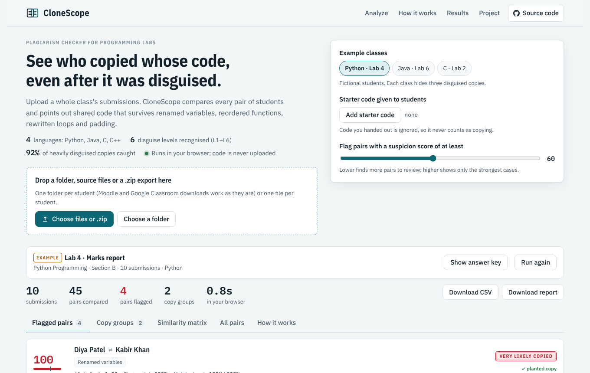
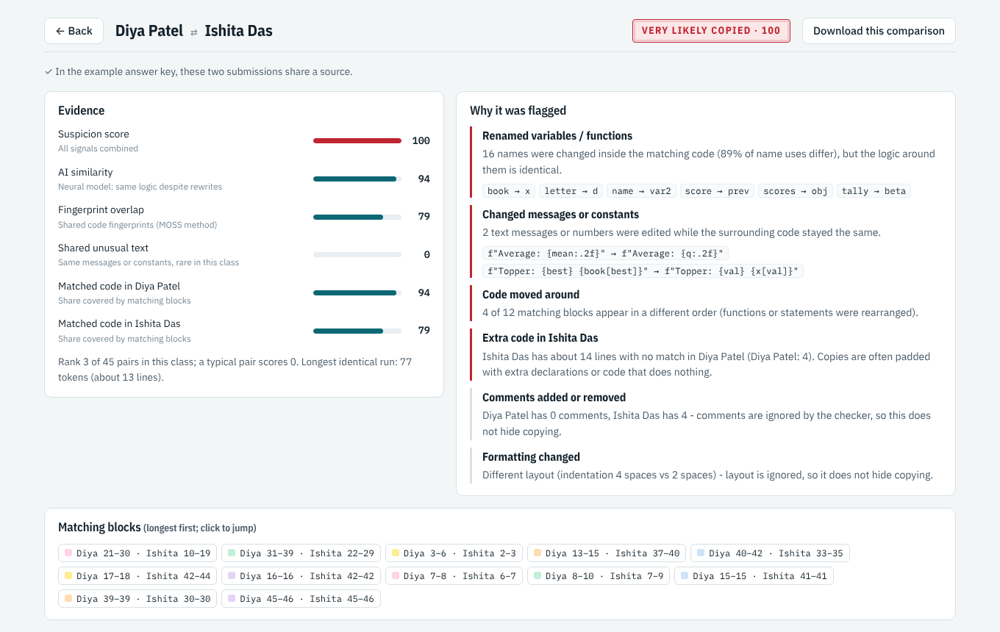

# CloneScope

[](https://puneetraghav-dev.github.io/clonescope/)
[](LICENSE)


**AI that catches disguised code plagiarism in programming assignments.**

Upload a whole class's lab submissions (Python, Java, C or C++). CloneScope compares every pair of students and shows who shares code with whom, even after the copy was disguised with renamed variables, rewritten comments, reordered functions, `for` → `while` rewrites, flipped `if/else` blocks or padding. For each flagged pair it explains *which* disguises were used and highlights the matching code side by side.

* **Live app:** **https://puneetraghav-dev.github.io/clonescope/**
* **Offline:** download `dist/clonescope.html` and open it in any browser. It is one file and needs no server or internet.
* **Private by design:** the analysis runs in the browser, so student code is never uploaded anywhere.




---

## How it works (short version)

```
submissions ─▶ normalize tokens ─┬─▶ winnowing fingerprints (MOSS-style) ─┐
                                 ├─▶ greedy string tiling (JPlag-style) ───┤
                                 ├─▶ Siamese neural encoder (PyTorch → JS) ┼─▶ logistic-regression ─▶ score, groups,
                                 └─▶ shared unusual text and constants ────┘   fusion                explanations
```

1. **Normalize**: comments, layout and names disappear (`total += marks[i]` → `ID += ID [ ID ]`), so renaming hides nothing.
2. **Fingerprints**: winnowing hashes of 6-token runs, the algorithm behind Stanford's MOSS.
3. **Tiling**: the longest shared token runs in any order, as in JPlag. These are also the highlighted blocks.
4. **Neural similarity**: a dilated 1-D CNN (about 170k parameters) trained with contrastive learning to map a program and its disguised copies close together, and honest solutions of the same task far apart.
5. **Shared unusual text**: copied prompts and constants, ignoring text most of the class shares (what the assignment asked for).
6. **Fusion**: logistic regression turns the signals into a 0–100 suspicion score. The threshold is chosen on validation data.

The neural model is **self-supervised**: no human labelled anything. A tree-sitter-based disguise generator (`training/obfuscator/`) rewrites ~10k real programs from Rosetta Code and TheAlgorithms the way students do, at the six plagiarism levels of Faidhi & Robinson (L1 cosmetic … L6 logic changes). Different people's solutions to the same Rosetta Code task serve as hard "not copied" examples.

The full plain-English explanation, including likely viva questions, is in **[docs/HOW_IT_WORKS.md](docs/HOW_IT_WORKS.md)**.

---

## Results

Every method's threshold is tuned on the validation split only. Nothing is tuned on the test sets.

| Method | Held-out AUC | Copies caught after 3× L6 | IR-Plag AUC | IR-Plag AUC within a task | IR-Plag balanced accuracy |
|---|---|---|---|---|---|
| Text diff | 0.884 | 46% | 0.653 | 0.648 | 0.492 |
| Token matching (names not normalized) | 0.989 | 56% | 0.622 | 0.641 | 0.510 |
| Winnowing (MOSS-style) | 1.000 | 81% | 0.681 | 0.680 | 0.561 |
| String tiling (JPlag-style) | 1.000 | 80% | 0.705 | 0.681 | 0.558 |
| Neural encoder alone | 1.000 | 84% | 0.629 | 0.648 | 0.530 |
| **CloneScope (fused)** | **1.000** | **92%** | **0.705** | **0.685** | **0.567** |

* **Held-out**: 986 programs from Rosetta Code tasks never seen in training, with 7,864 disguised copies (L1–L6), against independent solutions of the same tasks and different-task pairs.
* **Copies caught after 3× L6**: the strongest disguise applied three times in a row (2,949 copies), at each method's validated threshold.
* **IR-Plag** (Karnalim et al., 2019): 355 Java files plagiarized *by hand* and 105 independent solutions of 7 textbook exercises. It is hard for every method because honest solutions of tiny textbook exercises nearly match the original, while the L4–L6 copies were heavily refactored. Refitting the fusion weights on IR-Plag (leave-one-task-out) raises the within-task AUC to 0.769.
* The disguise generator is verified: all 2,461 disguised test programs compile and run, and all 2,425 from output-preserving operations print identical output (`results/obfuscator_check.txt`).
* Example classes in the app: all 12 planted copy pairs score 100, and the highest-scoring honest pair scores 41.

Section 5 of the walkthrough discusses what these numbers mean, including a note on how the shared-text signal was developed.

Graphs: `results/roc.png`, `results/recall_by_level.png`, `results/score_distribution.png`. All numbers: `results/metrics.json`.

---

## Quick start

### Use the app
Open `dist/clonescope.html`, or the live link. Then either pick an example class or drop in your own:

* a **folder** with one sub-folder per student (Moodle / Google Classroom downloads work as they are),
* several **files**, one per student, or
* a **.zip** of either (zips inside the zip are opened too).

Optionally add the **starter code** you gave the students, so it is ignored.

### Command line
```bash
node tools/cli.mjs samples/python/class            # flagged pairs with explanations
node tools/cli.mjs my_class.zip --starter template.java --csv pairs.csv
```

### Rebuild the web app
```bash
npm install          # only esbuild (the bundler)
npm run build        # -> dist/clonescope.html
```

---

## Deploying the website

The app is a static page, so any free static host works.

* **GitHub Pages (used for the live link).** `.github/workflows/pages.yml` rebuilds the app on every push to `main` and publishes `site/` to the `gh-pages` branch. One-time setting: *Settings → Pages → Build and deployment → Deploy from a branch → `gh-pages` / root*.
* **Manually:** `npm run site` creates `site/` (index.html, preview image, `.nojekyll`). Upload that folder to Netlify, Vercel, Cloudflare Pages or any web server.
* **Streamlit Community Cloud (optional):** on share.streamlit.io choose this repository, branch `main`, file `streamlit/streamlit_app.py`. Free Streamlit apps sleep when idle, so open the link a minute before a demo.
* **Names and links on the page:** edit `web/site.json` (author, team, guide, department, institution, repository) and rebuild.

## Reproduce the training and evaluation

Requirements: Python 3.10+, Node.js 18+, git. A CPU is enough (training takes about half an hour on 2 cores).

```bash
pip install -r requirements.txt
npm install
bash training/fetch_data.sh                         # Rosetta Code, TheAlgorithms, IR-Plag (~200 MB) -> ../data

python training/build_corpus.py                     # 1. collect, filter, split by task
python training/make_pairs.py                       # 2. disguised copies (L1-L6)
node   training/tokenize_corpus.mjs                 # 3. tokenize with the app's tokenizer
python training/train_encoder.py --epochs 20        # 4. train the Siamese encoder
python training/stress_test.py                      # 4b. stacked-disguise test copies
node   training/extract_features.mjs                # 5. classical signals (IR-Plag read from ../data)
python training/embed_pairs.py                      # 5b. neural signal + JS parity cases
python training/fit_fusion.py                       # 6. fusion weights and threshold
python training/evaluate.py                         # 7. metrics + graphs -> results/
python tools/summarize_training.py                  # numbers for the "How it works" tab
python tools/make_samples.py                        # example classes
npm run build
```

## Tests

```bash
npm test                                  # engine unit tests (tokenizer, winnowing, tiling, zip, JS ↔ PyTorch parity)
python tests/check_obfuscator.py          # every disguise compiles and prints identical output (needs gcc, g++, javac)
node tests/e2e.mjs                        # the built app in a headless browser (needs Playwright)
```

---

## Project structure

```
engine/        similarity engine (JavaScript): tokenizer, winnowing, tiling, neural encoder, fusion, explanations, zip
web/           the web app (HTML, CSS, JS)
training/      data pipeline, disguise generator (obfuscator/), PyTorch training, evaluation
model/         trained encoder (encoder.bin / .json / .pt), fusion weights, training summary
results/       metrics.json, RESULTS.md, graphs
samples/       hand-written independent solutions + the generated example classes
tools/         build script, CLI, sample builder
tests/         unit, disguise and end-to-end tests
docs/          HOW_IT_WORKS.md, screenshots
dist/          built single-file app
```

## Tech stack

PyTorch (training) · tree-sitter (parsing for the disguise generator) · scikit-learn (fusion, metrics) · matplotlib (graphs) · plain JavaScript (engine and app, no frameworks, no runtime dependencies) · esbuild (bundling) · Playwright (browser tests).

## Data and credits

* Rosetta Code ([acmeism/RosettaCodeData](https://github.com/acmeism/RosettaCodeData)), GNU FDL, used for training only and not redistributed.
* TheAlgorithms ([github.com/TheAlgorithms](https://github.com/TheAlgorithms)), MIT, used for training only.
* IR-Plag: O. Karnalim, S. Budi, H. Toba, M. Joy, "Source Code Plagiarism Detection in Academia with Information Retrieval: Dataset and the Observation", *Informatics in Education* 18(2), 2019 ([dataset](https://github.com/oscarkarnalim/sourcecodeplagiarismdataset), Apache-2.0), used for evaluation only.
* Algorithms: winnowing (Schleimer, Wilkerson & Aiken, SIGMOD 2003), greedy string tiling (Wise, 1993), NT-Xent loss (Chen et al., SimCLR, 2020), plagiarism levels (Faidhi & Robinson, 1987).

## Limitations

A score is evidence for a person to review, not proof. CloneScope cannot tell who copied from whom, does not detect copying across languages, and very short programs are naturally similar. See section 8 of the walkthrough.

## License

MIT, see [LICENSE](LICENSE).
